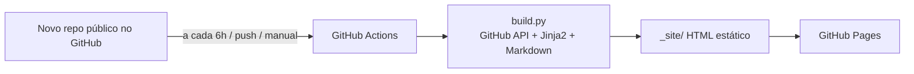

# rodrigocflorindo.github.io — Portfólio DevOps / SRE

Site estático gerado em **Python** a partir dos repositórios públicos do GitHub de [@rodrigocflorindo](https://github.com/rodrigocflorindo).
Cada repositório vira automaticamente um **artigo** com a explicação e o **lab** (README) do projeto. Hospedagem gratuita no GitHub Pages, sem backend.

**Site:** https://rodrigocflorindo.github.io

## Como funciona



1. `build.py` lê `config.yaml`, consulta a API do GitHub (perfil, repos, README, linguagens, estrutura de pastas).
2. Para cada repo **público** com o topic `portfolio` (configurável em `github.required_topic`; exceto forks, arquivados e itens em `github.exclude`) gera `projetos/<repo>/index.html`. Repos privados nunca entram.
3. Links e imagens relativos do README são reescritos para o GitHub; blocos ```` ```mermaid ```` viram diagramas.
4. Projetos são classificados por área (Kubernetes, IaC, Cloud, GitOps...) via `categories` no `config.yaml` + topics do repo.
5. O workflow `.github/workflows/deploy.yml` roda testes, gera o site e publica no Pages: em todo push, a cada 6h, manualmente (*Run workflow*) ou via `repository_dispatch` (`new-project`).

## Transformar um projeto em estudo de caso

O README do repositório é o **Lab** (passo a passo). Para adicionar a parte de **Estudo de caso** (problema, arquitetura, decisões, segurança, resultados), copie `content/projects/_exemplo.md` para `content/projects/<nome-do-repo>.md` e edite. O front matter permite trocar título, resumo, destaque, ordem, stack e categorias.

Dicas para recrutadores enxergarem senioridade:
- Adicione **description** e **topics** em cada repo (ex.: `kubernetes`, `terraform`, `argocd`) — eles alimentam cards e filtros.
- Coloque um diagrama de arquitetura (Mermaid ou imagem) e a seção "Como executar" no README.
- Para publicar um novo projeto: crie o repo **público** e adicione o topic `portfolio` (página do repo → ⚙ ao lado de *About* → *Topics*). Para publicar todos os repos públicos, use `required_topic: ""`.

## Rodar localmente

```bash
python -m venv .venv && . .venv/bin/activate
pip install -r requirements.txt
export GITHUB_TOKEN=$(gh auth token)   # opcional, evita o limite de 60 req/h da API
python build.py --dump-json data.json  # busca no GitHub e gera _site/
python build.py --from-json data.json  # regera offline (útil ao mexer no layout)
python -m http.server 8000 -d _site
pytest
```

## Publicação instantânea ao criar um repo (opcional)

Por padrão novos repos aparecem em até 6h. Para publicar na hora após um push em outro repo, crie um *fine-grained token* com permissão **Contents: read & write** neste repositório, salve como secret `PORTFOLIO_TOKEN` no outro repo e adicione:

```yaml
# .github/workflows/portfolio.yml (no repo do projeto)
on: { push: { branches: [main] } }
jobs:
  notify:
    runs-on: ubuntu-latest
    steps:
      - run: |
          curl -sf -X POST -H "Authorization: Bearer ${{ secrets.PORTFOLIO_TOKEN }}" \
            -H "Accept: application/vnd.github+json" \
            https://api.github.com/repos/rodrigocflorindo/rodrigocflorindo.github.io/dispatches \
            -d '{"event_type":"new-project"}'
```

## Estrutura

```
build.py              CLI do gerador
config.yaml           perfil, skills, destaques, filtros e categorias
portfolio/github.py   cliente da API do GitHub
portfolio/content.py  Markdown → HTML, links, resumo, categorias
portfolio/builder.py  coleta de dados e renderização das páginas
templates/            Jinja2 (home, projetos, artigo, feed, sitemap)
static/               CSS e JS (filtro de categorias)
content/projects/     estudos de caso opcionais por repo
tests/                pytest
```
