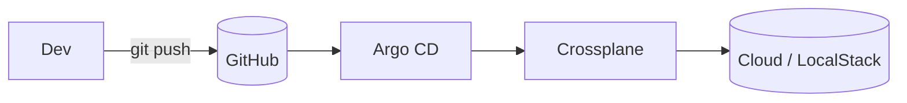

---
# Copie este arquivo para content/projects/<nome-do-repo>.md (sem o "_") para
# transformar o README do repositório em um ESTUDO DE CASO completo.
# Todos os campos são opcionais.
title: "Plataforma GitOps com Crossplane + Argo CD"
summary: "Provisionamento de infraestrutura cloud declarativo via Kubernetes, sincronizado por GitOps."
featured: true
order: 1
stack: ["Kubernetes", "Crossplane", "Argo CD", "LocalStack", "Terraform"]
categories: ["IaC", "GitOps & CI/CD", "Kubernetes"]
demo: ""
---

## Problema

Qual dor de negócio/operação este projeto resolve? (ex.: provisionamento manual, drift, falta de padronização)

## Arquitetura

## Decisões técnicas

- Por que Crossplane em vez de Terraform puro?
- Como segredos e credenciais são tratados?
- Trade-offs considerados.

## Segurança

Least privilege, gestão de segredos, políticas, scanning.

## Resultados

Métricas e ganhos: tempo de provisionamento, redução de erros, custo, MTTR.

## Próximos passos

O que você evoluiria com mais tempo.
