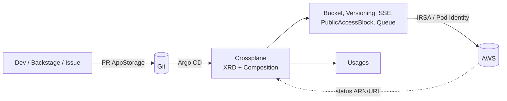

## Problema

Times de produto precisam de infraestrutura (bucket + fila) em minutos, mas cada pedido manual ou módulo Terraform copiado gera drift, configuração insegura e dependência do time de plataforma. Além disso, com o Terraform o drift só é percebido quando alguém roda `plan`.

## Arquitetura

## Decisões técnicas

- **XR namespaced (Crossplane v2) como interface do dev.** Substitui o Claim do v1: o dev escreve um `AppStorage` de ~10 linhas no namespace do time.
- **Composition em pipeline** (`function-patch-and-transform` + `function-auto-ready`) com 5 recursos gerenciados. Criptografia, bloqueio público e versionamento são obrigatórios e invisíveis para o dev.
- **Providers por serviço** do Upbound Marketplace (`provider-aws-s3`, `provider-aws-sqs`) em vez do monolito.
- **external-name determinístico** (`plat-<ns>-<nome>`), que permite IAM por prefixo e readoção após DR.

## Segurança

- Sem chave estática: a ServiceAccount do provider assume a role via **IRSA** ou **EKS Pod Identity**, e um `ProviderConfig` namespaced por time faz role chaining.
- **Usages** bloqueiam `kubectl delete` em recursos compostos e no XR de produção.
- Em `prod`, `managementPolicies` sem `Delete`: o Crossplane nunca apaga o recurso na AWS.
- IAM limitado a `plat-*`, e o Argo CD roda com `prune: false` e `selfHeal: true`.

## Resultados (medidos no lab)

- Bucket e fila apagados "no console" foram **recriados sozinhos** em ~49s e ~79s (`--poll=1m`).
- `kubectl delete` no bucket composto foi **negado** pelo webhook de Usage.
- Ao deletar o XR de prod, os recursos **ficaram na AWS**. Ao deletar o XR de dev, tudo foi removido.

## Próximos passos

- Composition para GCP/Azure atrás do mesmo XRD
- Policies (Kyverno) para regras por namespace
- Dashboard de drift corrigido no Grafana
