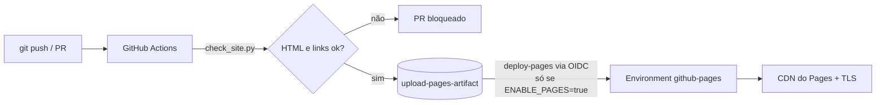

## Problema

Muita gente vê o GitHub Pages como "hospedagem grátis de HTML" e publica com o modo legado (branch + Jekyll), sem validação, com token salvo e sem entender os limites. Este lab explica **como o Pages funciona de verdade**, como torná-lo seguro e onde ele ajuda no dia a dia de DevOps/SRE. Ele não é um site publicado; é uma prova técnica.

## Arquitetura

## Decisões técnicas

- **Publicação por GitHub Actions, não por branch:** qualquer gerador, quality gate antes de publicar e sem o limite de 10 builds/hora.
- **Deploy atômico por artefato:** rollback é re-rodar o workflow de um commit anterior.
- **Deploy opcional via variável `ENABLE_PAGES`:** o repo funciona como template. Quem copia liga a publicação, e quem só estuda fica com a validação.
- **Validador sem dependências** (`scripts/check_site.py`, só stdlib): tags fechadas e links internos existentes.

## Segurança

- Deploy por **OIDC** (`id-token: write`), sem PAT nem segredo de longa duração.
- `permissions:` mínimas, environment `github-pages` restrito à `main` e actions fixadas por SHA como recomendação.
- Verificação de domínio na conta contra *subdomain takeover*, mais CAA liberando o Let's Encrypt.
- CSP via `<meta>`, porque o Pages não aceita headers HTTP customizados.

## Discussão sênior

- **Limites oficiais:** site de até 1 GB, deploy com timeout de 10 min e banda *soft* de 100 GB/mês. Saber quando migrar para S3 + CloudFront ou Cloudflare Pages com IaC faz parte da decisão.
- **Usos de engenharia:**
  - runbooks versionados linkados no `runbook_url` dos alertas;
  - repositório Helm com `chart-releaser`;
  - status page com Upptime;
  - histórico de benchmarks e relatórios de CI;
  - docs de Terraform e de API.
- **Portfólio derivado da fonte da verdade:** este próprio site gera um artigo para cada repo com o topic `portfolio`, o mesmo princípio de GitOps.

## Próximos passos

- Exemplo com MkDocs para runbooks
- Exemplo de repositório Helm com chart-releaser
- Link checker externo (lychee) agendado
